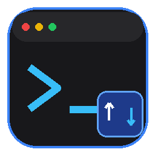

<div align="center">

  

  # OpenMoba

  **Cliente SSH & Explorador SFTP Moderno, Leve e Multiplataforma**  
  *Inspirado na experiência e produtividade do MobaXterm — focado no que realmente importa.*

  [](https://www.python.org/)
  [](https://wiki.qt.io/Qt_for_Python)
  [](https://github.com/)
  [](https://xtermjs.org/)
  [](https://cryptography.io/)
  [](LICENSE)

</div>

---

## 📌 Visão Geral

O **OpenMoba** nasceu para atender desenvolvedores, administradores de sistemas e engenheiros DevOps que amam o fluxo de trabalho do **MobaXterm** (painel lateral com sessões salvas e navegador SFTP dinâmico à esquerda, abas de terminal à direita), mas precisam de uma alternativa:
- 🐧 **100% Multiplataforma**: Funciona nativamente no **Linux** e no **Windows**.
- 🪶 **Leve e Rápida**: Sem o peso de servidores X11, emuladores Cygwin, RDP, VNC ou ferramentas não relacionadas a conexões SSH/SFTP.
- 🔓 **Código Aberto e Gratuito**: Sem limitações de abas, sessões ou mensagens comerciais.
- ⚡ **Zero-Configuração**: Cria automaticamente seu próprio ambiente virtual isolado (`.venv`) e instala apenas as dependências necessárias com um único clique.

---

## ✨ Funcionalidades Principais

### 💻 1. Terminal SSH Moderno (`xterm.js` + WebEngine)
- **Emulação Completa**: Renderização via `xterm.js` embutido com suporte a cores **TrueColor (24-bit)**, fontes modernas com ligaduras (*Cascadia Code* / *Fira Code*) e atalhos completos de terminal.
- **PTY e I/O Assíncrono**: Backend baseado em `asyncssh` e `qasync` garantindo fluidez e latência mínima sem travar a interface.
- **Redimensionamento Automático**: O terminal calcula linhas e colunas instantaneamente ao redimensionar a janela ou dividir painéis.

### 📁 2. Explorador SFTP com Isolamento por Aba
- **Diretório Independente por Sessão**: Cada aba de terminal possui seu próprio gerenciador SFTP dedicado. Se você estiver em `/var/log` na Aba 1 e em `/home/deploy` na Aba 2, alternar entre as abas preserva a pasta exata de cada uma sem resetar.
- **Upload por Arraste (Drag & Drop)**: Arraste arquivos ou pastas inteiras do Windows Explorer ou do gerenciador de arquivos do Linux diretamente para o painel SFTP.
- **Detecção Inteligente de Subpastas**: Soltar um arquivo sobre uma pasta na lista faz o envio direto para dentro dela.
- **Operações Rápidas**: Envio recursivo de pastas inteiras, download, criação de diretórios e exclusão via menu de contexto do botão direito.
- **Indicador de Status em Tempo Real**: Feedback visual com animação e contadores de progresso durante uploads e downloads.

### 🔲 3. Abas Destacáveis (Modo Flutuante para Múltiplos Monitores)
- **Drag to Detach**: Arraste qualquer aba de terminal para fora da janela para transformá-la em uma janela flutuante independente.
- **SFTP Acompanha a Sessão**: A janela destacada leva consigo o explorador SFTP dedicado daquela sessão (com botão para ocultar/exibir quando quiser).
- **📌 Reanexação com 1 Clique**: Clique em *"Reanexar à Janela Principal"* na janela destacada e ela voltará imediatamente como aba na janela principal, mantendo a sessão SSH conectada e o SFTP na mesma pasta.
- **Menu de Contexto nas Abas**: Botão direito permite fechar a aba, fechar outras abas ou destacar diretamente.

### 🔐 4. Cofre de Sessões Criptografado & Busca Rápida
- **Criptografia Forte Local**: As credenciais salvas são protegidas com criptografia simétrica **Fernet (AES-128 CBC + HMAC-SHA256)** com derivação de chave **PBKDF2** e salt único gerado na máquina.
- **Filtro de Busca em Tempo Real**: Localize servidores instantaneamente pelo campo de busca `🔍 Filtrar sessões...`.
- **Autenticação Flexível**: Suporte a chaves privadas (`.pem`, `.id_rsa`, `id_ed25519`) ou autenticação por senha com solicitação sob demanda.

### 🔄 5. Detecção Inteligente do MobaXterm
- **Detecção Automática do Usuário**: Identifica dinamicamente a presença do MobaXterm e suas configurações (`MobaXterm.ini`) no perfil do usuário atual do Windows (`%APPDATA%`, `Documentos`, `Desktop` ou versões portáteis).
- **Sincronização com 1 Clique**: Se o MobaXterm for detectado, o botão *"🔄 Sincronizar MobaXterm"* aparece na barra de ferramentas para importar sessões existentes sem criar duplicatas.
- **Interface Limpa**: Se o MobaXterm não estiver instalado na máquina (ou no Linux), o botão fica oculto mantendo a barra de ferramentas limpa.

### 🎨 6. Design Dark Pro Moderno
- Paleta de cores ergonômica e refinada inspirada no VS Code e MobaXterm Modern.
- Ícones em vetor (SVG) nítidos em monitores High-DPI.
- Painel lateral redimensionável e retrátil via divisor suave (splitter).

---

## 🏗 Arquitetura do Projeto

```
openmoba/
├── main.py                     # Inicializador inteligente & Auto-bootstrapper
├── openmoba.bat                # Inicializador de 1 clique para Windows
├── openmoba.sh                 # Inicializador de 1 clique para Linux
├── requirements.txt            # Dependências Python mínimas
├── README.md                   # Documentação do projeto
├── .gitignore                  # Arquivos ignorados no Git
└── src/
    ├── __init__.py
    ├── main_window.py          # Janela principal, orquestração de abas e painel lateral
    ├── sftp_browser.py         # Navegador SFTP com suporte a Drag & Drop e progresso
    ├── detached_window.py      # Janela flutuante para sessões destacadas (Terminal + SFTP)
    ├── detachable_tab_bar.py   # Barra de abas customizada com drag-to-detach
    ├── ssh_backend.py          # Conexões assíncronas SSH & SFTP via asyncssh
    ├── terminal_widget.py      # Ponte WebEngine / QWebChannel integrando xterm.js
    ├── session_store.py        # Armazenamento criptografado e sincronização MobaXterm
    ├── session_dialog.py       # Diálogo modal para criar/editar sessões
    ├── styles.py               # Tema visual Dark Pro em QSS
    └── resources/
        ├── icons/              # Ícones oficiais da aplicação (PNG, ICO, SVG)
        └── web/                # Emulador de terminal offline (xterm.js, css, addons)
```

---

## ⚡ Instalação e Execução

Você **não precisa instalar pacotes globalmente** nem configurar o ambiente virtual manualmente. O inicializador cuida de tudo.

### 🪟 No Windows (1 Clique)
Basta dar dois cliques em:
```cmd
openmoba.bat
```
*Ou pelo terminal:*
```cmd
python main.py
```

---

### 🐧 No Linux (1 Clique)
Dê permissão de execução (se necessário) e inicie:
```bash
chmod +x openmoba.sh
./openmoba.sh
```
*Ou pelo terminal:*
```bash
python3 main.py
```

> [!NOTE]
> **Dependências de sistema no Linux (Debian / Ubuntu / Mint):**  
> Para garantir o funcionamento das bibliotecas gráficas do Qt WebEngine no Linux, certifique-se de que os pacotes básicos do sistema estejam instalados:
> ```bash
> sudo apt update && sudo apt install -y python3-venv libgl1 libegl1 libxkbcommon-x11-0
> ```

---

## 🛠 Modo de Desenvolvimento Manual (Opcional)

Se preferir gerenciar o ambiente virtual manualmente com `pip`:

```bash
# 1. Clone o repositório
git clone https://github.com/seu-usuario/openmoba.git
cd openmoba

# 2. Crie e ative o ambiente virtual
python -m venv .venv

# No Windows:
.venv\Scripts\activate

# No Linux:
source .venv/bin/activate

# 3. Instale as dependências
pip install -r requirements.txt

# 4. Execute a aplicação
python main.py
```

---

## 📦 Dependências Utilizadas

| Pacote | Versão | Função |
| :--- | :--- | :--- |
| **PySide6** | `>= 6.5.0` | Interface gráfica Qt6 e motor WebEngine para o terminal |
| **asyncssh** | `>= 2.14.0` | Comunicação SSH assíncrona de alta performance e cliente SFTP |
| **cryptography** | `>= 41.0.0` | Criptografia local simétrica (Fernet AES + PBKDF2) |
| **qasync** | `>= 0.27.0` | Integração perfeita entre o event loop do `asyncio` e o Qt |
| **xterm.js** | `v5.3.0` | Emulador de terminal HTML5/JS incorporado localmente |

---

## 🛡 Segurança e Privacidade

- **Armazenamento 100% Local**: O OpenMoba armazena todas as sessões em `~/.openmoba/sessions.enc`.
- **Chave Única**: Derivada com PBKDF2 HMAC-SHA256 e salt randômico de 128 bits gerado individualmente por máquina.
- **Zero Telemetria**: O aplicativo não envia métricas, dados ou diagnósticos para a internet. Todas as conexões partem estritamente da sua máquina para o servidor SSH configurado.

---

## 🤝 Contribuições

Contribuições são muito bem-vindas! Se você tem sugestões de melhorias, correções de bugs ou novas funcionalidades:

1. Faça um Fork do projeto.
2. Crie uma Branch para sua feature (`git checkout -b feature/nova-funcionalidade`).
3. Commit suas alterações (`git commit -m 'feat: adiciona nova funcionalidade'`).
4. Faça o Push para a Branch (`git push origin feature/nova-funcionalidade`).
5. Abra um **Pull Request**.

---

## 📄 Licença

Distribuído sob a licença **MIT**. Veja o arquivo `LICENSE` para mais detalhes.

<div align="center">
  <sub>Desenvolvido com foco em produtividade, leveza e elegância.</sub>
</div>
